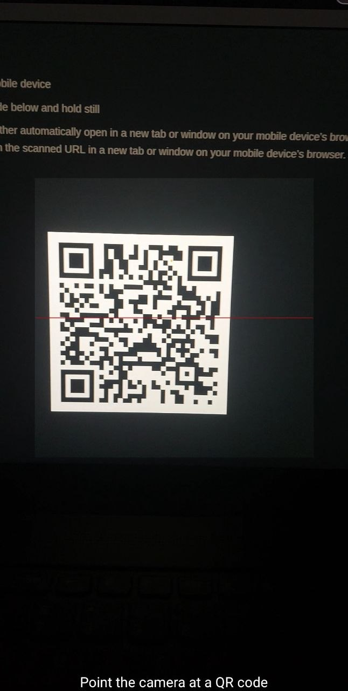
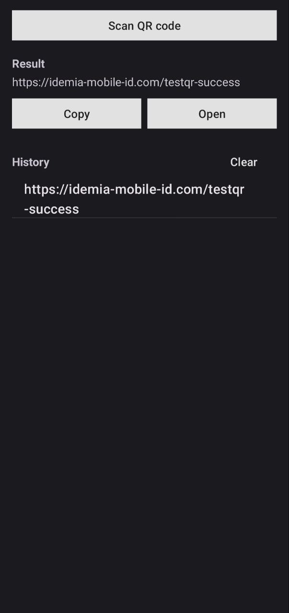
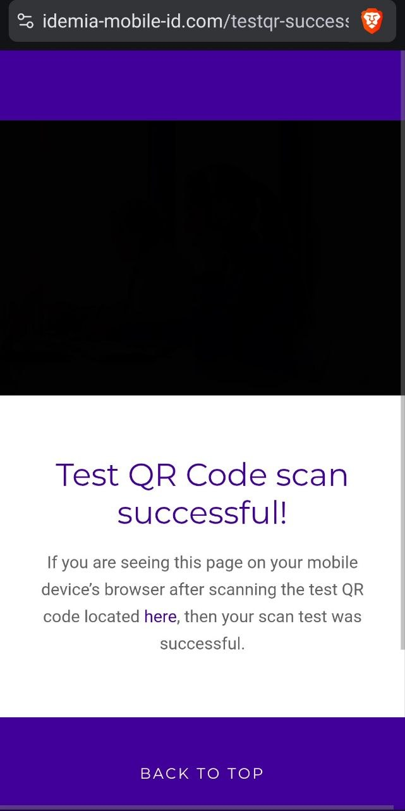
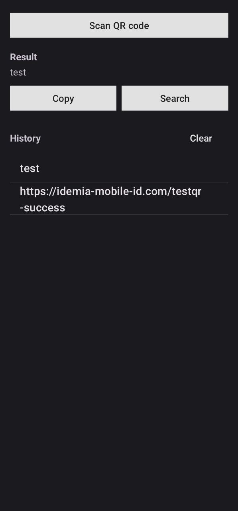
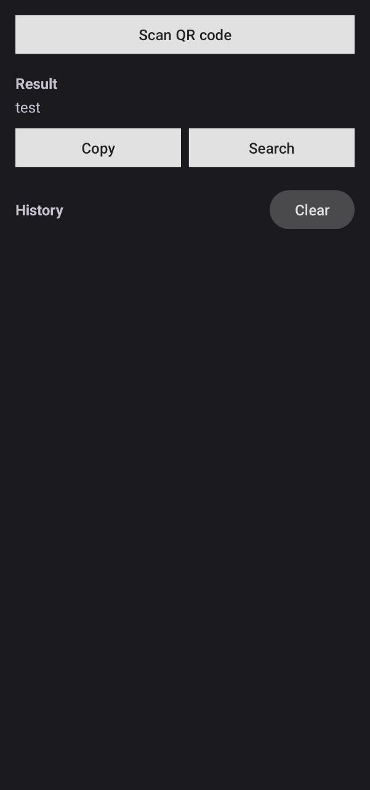

# Laboratory Work 3: QR Code Scanner (Android, Kotlin)

Task variant: QR code scanner. Create an Android application that scans QR codes and shows the encoded information. The application is written in Kotlin, logs its work through a configured logger and supports two languages with the Android i18n resources.

## Features
* **Scan on start:** the camera opens as soon as the app starts. After a scan the main screen shows the result. The "Scan QR code" button opens the camera again.
* **Continuous autofocus:** the scanner screen (`ScannerActivity`) extends the zxing `CaptureActivity` and turns on continuous focus. By default the library refocuses the camera only once every 2 seconds.
* **Open or search:** one button changes its action depending on the content. Links, phone numbers, e-mail addresses, SMS and map locations are opened in a matching app. Any other text is searched on Google.
* **Copy:** the scanned value is copied to the clipboard.
* **History:** every scan is saved in `SharedPreferences` as a JSON array, newest first. Tapping an item shows it again. The history can be cleared.
* **Localization:** English (default) and Ukrainian strings in `values/` and `values-uk/`. There is no hard-coded text in the code or layouts. On Android 13+ the language can be chosen for the app only (`locales_config.xml`).
* **Logging:** all messages go through Timber. Logs are written to Logcat only in debug builds, release builds log nothing. The QR content itself is never logged, only its length.
* **UI:** portrait only, follows the system light/dark theme, neutral gray colors, square buttons and a custom app icon.

## Supported QR Content

| Content                         | Example                          | What the app does                          |
|---------------------------------|----------------------------------|--------------------------------------------|
| Plain text                      | `Hello, world`                   | show, copy, search on Google               |
| Link                            | `https://example.com`            | open in the browser                        |
| Phone number                    | `tel:+380501234567`              | open the dialer                            |
| E-mail                          | `mailto:name@example.com`        | open the mail app                          |
| SMS                             | `smsto:+380501234567`            | open the SMS app                           |
| Location                        | `geo:50.45,30.52`                | open the map                               |
| Wi-Fi, contact, calendar event  | `WIFI:...`, `BEGIN:VCARD...`     | shown as text, copy and search only        |
| Other barcodes (EAN, Data Matrix) | –                              | not recognized, the scanner reads QR only  |

## How It Works

    App start ──► Scanner (camera) ──► QR found ──► Main screen
                       │                              ├── Result
                       │ Back                         ├── Copy | Open / Search
                       ▼                              └── History (tap to show again, Clear)
                  Main screen ◄──── "Scan QR code" button opens the scanner again

## Screenshots

| Scanner | Link Scanned | Link: Open |
|:---:|:---:|:---:|
|  |  |  |

| History | Clear History | Ukrainian |
|:---:|:---:|:---:|
|  |  |  |

## Project Structure

    app/src/main/java/com/example/qrscanner
    ├── App.kt                    Application class, sets up Timber
    ├── MainActivity.kt           main screen: result, copy, open/search, history
    ├── QrActions.kt              copy, open and search actions for the scanned value
    ├── ScannerActivity.kt        scanner screen with continuous autofocus
    └── HistoryStorage.kt         saves the scan history in SharedPreferences
    app/src/main/res
    ├── layout/activity_main.xml
    ├── values/strings.xml        English strings (default)
    ├── values-uk/strings.xml     Ukrainian strings
    ├── values/, values-night/    colors and theme for light and dark mode
    ├── xml/locales_config.xml    languages for the per-app language setting
    └── drawable-nodpi/           app icon image

## Technologies Used
* Kotlin
* Android Gradle Plugin 9.5.1 (minSdk 24, targetSdk 37)
* zxing-android-embedded 4.3.0
* Timber 5.0.1
* AndroidX AppCompat, Material Components (Material 3 theme)

## How to Run

You need the Android SDK (for example, installed with Android Studio) and an Android phone with USB debugging turned on.

1. **Connect the phone and check that it is visible:**

    `adb devices`

2. **Build and install the debug version:**

    `./gradlew installDebug`

3. **Open "QR Scanner" on the phone** and allow camera access.

## Viewing Logs

Run the app and execute:

    adb logcat -s App MainActivity ScannerActivity HistoryStorage QrActions

Example output:

    I App             : Application started
    D MainActivity    : Starting scanner
    D ScannerActivity : Scanner opened with continuous autofocus
    I MainActivity    : Scanned QR code, length=23
    D HistoryStorage  : Saved to history, total items: 4
    I QrActions       : Opened value with scheme=https

## Changing the Language

* Set the phone language to Ukrainian (it must be first in the language list), or
* on Android 13+: Settings → Apps → QR Scanner → Language.